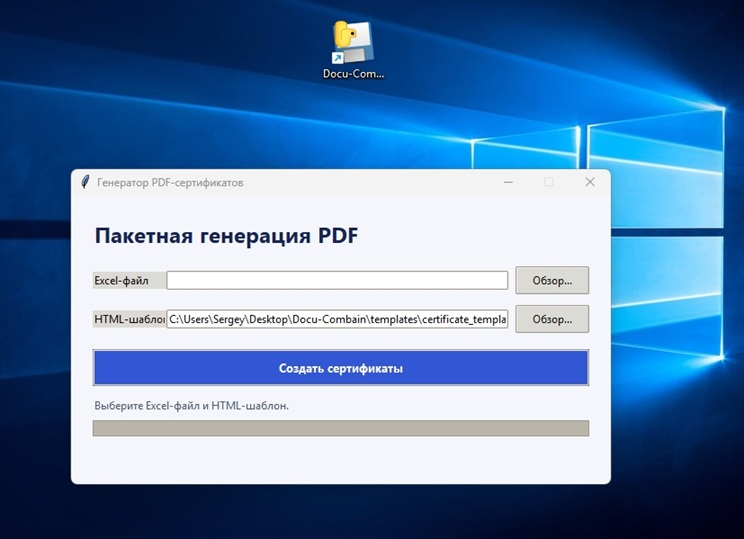

# Docu-Combain

Desktop-приложение на Python для пакетного создания PDF-сертификатов из
Excel-таблицы и HTML-шаблона. Генерация выполняется в фоновом потоке, поэтому
интерфейс остаётся отзывчивым.

## 📸 Интерфейс приложения



## 📄 Пример сгенерированного документа

Вы можете ознакомиться с примером готового документа, сгенерированного системой на основе HTML/CSS шаблона:
👉 **[Посмотреть сгенерированный сертификат](./certificate_001.pdf)**

## Возможности

- Чтение `.xlsx` через `openpyxl`, проверка обязательных колонок и пропуск
  пустых строк.
- Подстановка значений Excel в HTML-плейсхолдеры вида `{{ student_name }}`.
- Экранирование значений для HTML и форматирование дат как `ДД.ММ.ГГГГ`.
- Необязательные изображения подписи и печати из локальной папки `assets/`.
- Создание PDF через WeasyPrint, отображение прогресса и ошибок в Tkinter.
- Сборка Windows-приложения через PyInstaller.

## Требования

- Python 3.10 или новее.
- Tkinter (обычно входит в установщик Python для Windows).
- Для WeasyPrint могут потребоваться системные библиотеки, соответствующие
  вашей операционной системе. См. документацию WeasyPrint.

## Установка и запуск

Из каталога проекта создайте виртуальное окружение и установите зависимости:

```powershell
py -3 -m venv .venv
.\.venv\Scripts\Activate.ps1
python -m pip install --upgrade pip
python -m pip install -r requirements.txt
python desktop_app.py
```

Для запуска на Linux/macOS активируйте окружение командой
`source .venv/bin/activate`, затем запустите `python desktop_app.py`.

## Данные и шаблон

Приложение требует Excel-файл `.xlsx` с заголовками:

| Колонка | Назначение |
| --- | --- |
| `student_name` | Имя получателя; также используется в имени PDF |
| `course_name` | Название курса |
| `score` | Баллы или результат |
| `issue_date` | Дата выдачи |
| `signature_path` | Необязательный путь к подписи |
| `stamp_path` | Необязательный путь к печати |

Шаблон по умолчанию находится в `templates/certificate_template.html`.
Плейсхолдеры должны совпадать с именами колонок Excel. Подписи и печати можно
положить в `assets/`; относительные значения в колонках `signature_path` и
`stamp_path` разрешаются относительно этой папки. Пустое значение убирает
соответствующее изображение из шаблона.

Личные таблицы, изображения, PDF и журналы намеренно исключены из Git.
Пример с реальными данными не распространяется: выберите собственный `.xlsx`
в окне приложения. Готовые PDF сохраняются в
`Documents/CertificateGenerator/output`.

## Тесты

```powershell
python -m unittest discover -s tests -v
```

## Сборка Windows-приложения

```powershell
python -m pip install -r requirements-build.txt
pyinstaller --clean --noconfirm desktop_app.spec
```

Готовый исполняемый файл будет создан в `dist/desktop_app.exe`.

## GitHub

Создайте на GitHub репозиторий `docu-combain`, затем укажите его URL в качестве
`origin` и отправьте ветку `main`:

```powershell
git remote add origin https://github.com/<YOUR-USERNAME>/docu-combain.git
git push -u origin main
```

## Лицензия

Проект распространяется по лицензии [MIT](LICENSE). Она разрешает использование,
изменение и распространение проекта, в том числе в коммерческих целях, при
сохранении уведомления об авторских правах и текста лицензии.
